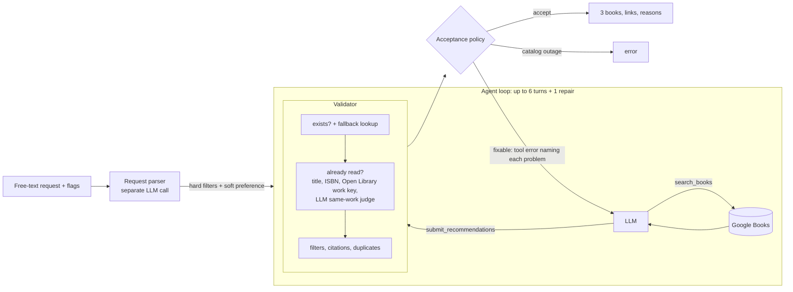

# Next Read Agent


An agent that recommends three books from your Goodreads history, each with a link and a reason that cites books you've read. The LLM proposes. Code checks the hard rules: the books exist, you haven't read them in any edition or translation, and they meet your filters.

LLMs alone invent books or recommend ones you've already read. This project measures how much an agent with verification fixes that: **the agent passes every hard rule in 85% of round 2 runs, against 21% for a single prompt with the whole library.**

```text
$ uv run python -m book_agent.cli agent "A sci fi book that is not about space"
Prompt agent_v3 | feedback submission_feedback_v1 | request parser request_parser_v3
Request: "A sci fi book that is not about space"
Preference: A sci fi book that is not about space
Filters: none

Iterations: 6 of 6 | Submissions: 2 (1 rejected)

Rejection 1:
- [cites_library] 'Station Eleven' by Emily St. John Mandel: the reason cites no book from the reader's history

1. Never Let Me Go by Kazuo Ishiguro
   Reason: Like The Ocean at the End of the Lane, this poignant speculative novel explores memory, loss, and human identity in a grounded, earthly setting rather than outer space.
   Matched: Never Let Me Go | https://play.google.com/store/books/details?id=JAzxznMKiq4C
   Pages: 274 | Language: en
   Checks: exists=pass, not in library=pass, cites history=pass

2. Severance by Ling Ma
   ...
3. The Ministry for the Future by Kim Stanley Robinson
   ...

Result: PASSED

LLM calls:
- interpret_request: gemini-3.5-flash-lite | 771 in, 38 out | 3.92s
- agent: gemini-3.5-flash-lite | 4444 in, 21 out | 4.24s
  ... 5 more agent turns
Total: 30733 in, 475 out
```

*(A real round 2 eval run, printed by the CLI's formatter.)*

## How it works



- **Request interpretation** is a separate call (D-005). If one reply both interpreted and recommended, a misread filter would pass unnoticed. Flags override interpreted filters.
- **The agent** searches Google Books and submits through a forced tool call. There's no free-text JSON (D-010).
- **The validator** reports violations and unknowns, never a silent pass (D-002). "Already read" works at the level of works, not editions. Title variants and ISBNs come first, then Open Library work keys, then an LLM same-work judge for translations (D-011, D-012).
- **The acceptance policy** is a pure function. It rejects violations and books it can't verify. The model gets a tool error listing each problem and replaces only the rejected books (D-014).

More: [ARCHITECTURE.md](docs/ARCHITECTURE.md) (components and patterns), [DECISIONS.md](docs/DECISIONS.md) (42 design decisions), [FINDINGS.md](docs/FINDINGS.md) (22 findings).

## Results

Round 2 of `recommend_v1`: 13 cases × 3 runs per system, `gemini-3.5-flash-lite`, the same request parser and validator for both. The baseline is one call with the whole library and no tools.

| | Baseline | Agent |
| --- | --- | --- |
| Accepted | 8/39 (21%) | 33/39 (85%) |
| Accepted, outages excluded | 8/39 (21%) | 33/35 (94%) |
| Main final failures | already read 20, not found 18, reason cites no read book 9, unparseable 5 | Gemini 503 4, out of turns 2 (not found 2) |
| Judge: `fits_request` no | 16/68 (24%) | 4/86 (5%) |
| Judge: bad reasons (lower bound) | 9/80 (11%) | 2/103 (2%) |
| Requests per run | 2.1 | 6.3 |
| Tokens per run (in / out) | 4,548 / 225 | 25,553 / 398 |
| Latency per run (mean / p95) | 8.1s / 11.5s | 26.0s / 39.5s |

Judge rows cover every recommended book that exists in the catalog, in accepted and rejected runs. `fits_request` is only judged when there's request text.

**Caveats:**
- **One reader, 13 cases.** All results come from one reader's library (mine) and 13 cases.
- **3 runs per case.** Run-to-run noise is about 2 or 3 runs in 39 (F-013), so only large differences count. This one is large.
- **The judge** (`judge_v3`) was calibrated against my blind labels on a tuning half, then checked once on a held-out half with thresholds set in advance (D-034, F-017):
  - `fits_request` is reliable: 75% exact, 94% within one step.
  - It catches about 1 in 5 bad reasons, so the bad-reason rate is a lower bound for both systems. The comparison holds; the absolute numbers don't.
  - "Good reason" verdicts are unreliable and aren't reported here.
  - The judge is the same model family as the recommender (`gemini-3.5-flash-lite`), so it may favor text in its own style (D-033). Calibration against my labels measures this, and it does lean lenient.
- **The agent's price** is about 3× the requests and latency, and 5.6× the input tokens.

## What failed and what I learned

A selection. Each one links to the full entry: what happened, how it was detected, the fix, and how it was verified.

- **The translated Kafka ([F-001](docs/FINDINGS.md#f-001--translated-title-of-a-read-book-recommended-and-passed-validation-2026-11-15), [F-002](docs/FINDINGS.md#f-002--first-baseline-runs-prompt-only-exclusion-is-unreliable-2026-11-15)).** The baseline recommended *The Metamorphosis* to a reader who had read *La metamorfosis*. The model's own reason mentioned it, and validation passed. A prompt rule didn't fix it, so the fix moved into code: work-level matching with an LLM same-work judge.
- **"El coronel en su laberinto" ([F-002](docs/FINDINGS.md#f-002--first-baseline-runs-prompt-only-exclusion-is-unreliable-2026-11-15)).** A plausible title that doesn't exist, a blend of two García Márquez titles. It's why existence checks against a real catalog are a hard rule, and why replies come back through tool calls rather than JSON that can fail to parse first.
- **One "&" rejected a real book ([F-007](docs/FINDINGS.md#f-007--first-real-rejection-no-turn-left-to-fix-it-and-the-rejection-was-a-false-positive-2026-11-18)).** *The News from Ireland & Other Stories* came back as "not found" because the literal "&" sent Google Books to reference works. A retrieval miss looks exactly like a hallucination, so "not found" now needs a second, stricter lookup.
- **Searching one book per turn ([F-005](docs/FINDINGS.md#f-005--the-agent-searched-to-confirm-books-it-already-had-in-mind-and-ran-out-of-turns-2026-11-17), [F-006](docs/FINDINGS.md#f-006--agent_v2-passes-all-5-requests-hard-rules-cant-see-quality-2026-11-17)).** The agent used search to confirm books it already had in mind, one per turn, and ran out of turns. Prompting for parallel searches helped, but it still happens in 18 of 39 round 2 runs. Forced submission on the last turn bounds the cost (D-028).
- **Small error rates compound across steps ([F-012](docs/FINDINGS.md#f-012--the-8-agent-failures-in-f-011-transient-503s-and-late-submission-2026-11-19), [F-014](docs/FINDINGS.md#f-014--the-4-llm_error-runs-in-f-013-transient-gemini-503s-clustered-in-time-2026-11-22)).** A 1.6% Google Books 503 rate failed 4 runs in 39 (10%), because a run makes about 10 requests and one failed validation lookup stops it. Retries in a decorator fixed that. Gemini 503s later clustered in time, so the report now gives an acceptance rate that leaves out outages.
- **A parser that silently dropped constraints ([F-009](docs/FINDINGS.md#f-009--the-request-parser-drops-soft-constraints-it-cant-turn-into-filters-2026-11-18), [F-010](docs/FINDINGS.md#f-010--request_parser_v2-equal-score-cheaper-errors-2026-11-18)).** `request_parser_v1` removed "between 200 and 400 pages" because it couldn't express the minimum. v2 scored the same 21/23, but its errors were harmless repeats, not lost constraints. Equal accuracy hid errors of very different cost.
- **Keeping prompt examples out of the eval set ([D-035](docs/DECISIONS.md#d-035--judge_v2-independent-criteria-concrete-connections-form-mismatch-is-a-no-2026-11-23)).** A check of the judge's examples against the calibration sample found "nothing by Brandon Sanderson" and "around 700 pages", taken from eval requests. That's the evaluation leaking into the prompt, so they were replaced.
- **RAG over the reader's library didn't add variety ([F-022](docs/FINDINGS.md#f-022--agent_v4-library-retrieval-meets-4-of-7-thresholds-and-misses-the-diversity-goal-2026-11-25)).** agent_v4 embeds the reader's books and shows the agent the 8 most related to each request, so reasons would cite relevant books instead of the same favorites. The agent followed it (83% of citations), acceptance and cost held, but the diversity goal set in advance was missed: 38 distinct books cited against 36, and 4 reused across cases against 6. Retrieval brought its own hub books, ignored negation ("nothing from Sanderson" retrieved Sanderson) and filled the list when nothing was similar. A negative result, kept as recorded. agent_v3 stays the default.
- **Class imbalance hid a blind spot ([F-017](docs/FINDINGS.md#f-017--judge_v3-passes-the-held-out-thresholds-but-the-no-vs-rest-threshold-cant-see-a-judge-that-never-says-no-2026-11-24)).** The judge passed a pre-registered 85% threshold on spotting bad reasons with 90%, while never saying "no" on the held-out half. Bad reasons are rare, so a judge that never says no would score the same. Rare classes need recall, not overall agreement. The thresholds stayed as recorded, and the caveat goes with the numbers.

## Limitations and next steps

- **Candidate retrieval is a live Google Books search.** Two spikes chose the catalog for a later step: Open Library's CC0 dumps, which cover 69–81% of the library and the Spanish cases, while Goodbooks-10k stops in 2017 and missed 7 of 13 cases ([F-018](docs/FINDINGS.md), [F-019](docs/FINDINGS.md), [D-040](docs/DECISIONS.md)). The embedding pipeline built for library retrieval is generic enough to reuse.
- **Only Gemini is implemented.** The `LLMClient` contract is provider-neutral, and a Claude adapter is next, so results can be compared across providers.
- **No API or UI yet.** FastAPI serves only a health check. Next: the recommendation endpoint, rate limits for a public demo, and a small React UI.
- **Quality isn't a hard rule.** An author exclusion ("nothing by X") is only a soft preference ([B-001](docs/BACKLOG.md)). The judge can't see the cited books' descriptions ([B-002](docs/BACKLOG.md)).

## Running it

Requires [uv](https://docs.astral.sh/uv/) and a Gemini API key (the free tier is enough).

```bash
uv sync
cp .env.example .env        # set GEMINI_API_KEY; every setting is documented there
# Export your library from Goodreads (My Books → Import and export) to:
#   data/goodreads_library_export.csv

uv run python -m book_agent.cli works          # optional: cache Open Library work keys (needs OPEN_LIBRARY_CONTACT)
uv run python -m book_agent.cli agent "algo corto y liviano" --language es
uv run python -m book_agent.cli baseline "a dystopia under 400 pages"
```

Add `--verbose` to the agent for a trace of each turn. The library-retrieval variant (agent_v4, F-022) needs its index first: `uv run python -m book_agent.cli library --yes`, then `agent --prompt agent_v4`. Checks: `uv run pytest` (live API tests are excluded; run them with `-m live`), `uv run ruff check .`, `uv run pyright`.

### Running the evals

Results go to `data/evals/` and stay local. Every command that calls an LLM prints a plan and an estimate of the requests first, and only starts with `--yes`.

```bash
uv run python -m book_agent.evals run --system baseline --yes   # 13 cases × 3 runs, resumable
uv run python -m book_agent.evals run --system agent --yes
uv run python -m book_agent.evals judge --yes                   # judge_v3 on every recommended book
uv run python -m book_agent.evals report --judge judge_v3-gemini-3.5-flash-lite-default
uv run python -m book_agent.evals parser --yes                  # request parser accuracy
```

Calibrating the judge against your own labels: `sample`, `label`, then `calibrate --split tuning`. The held-out half (`--split held-out`) is meant to be looked at once (D-034).

## License

[MIT](LICENSE)
