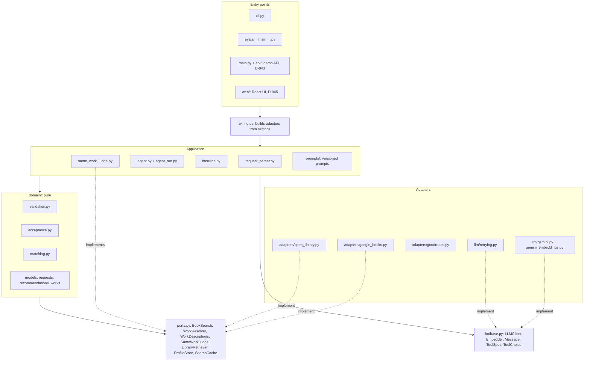
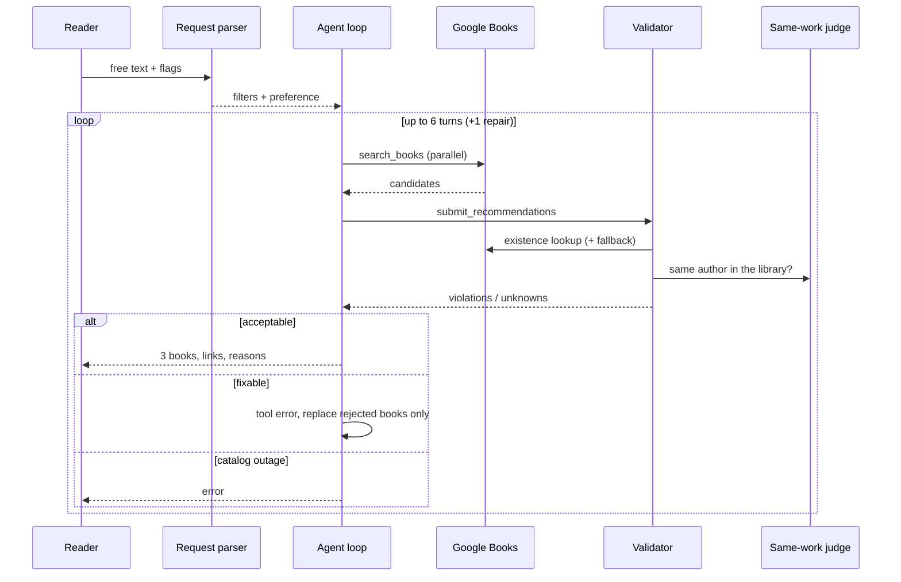

# Architecture

How the code is organized, and the design patterns it uses. Every choice links to its entry in [DECISIONS.md](DECISIONS.md). Real failures are in [FINDINGS.md](FINDINGS.md).

## Layers

- **`domain/`** holds models and pure rules. It never imports FastAPI, httpx or an LLM SDK. It reaches the outside only through the Protocols in `ports.py`.
- **`llm/base.py`** is the provider-neutral LLM contract: messages with text, tool call and tool result parts, tool specs, tool choice, stop reasons, usage and an error hierarchy. Provider adapters live next to it. `base.py` never imports a provider SDK.
- **`wiring.py`** is the only place concrete adapters are built from settings. The CLIs use it now, and FastAPI dependencies will use it later.
- **`prompts/`** holds every prompt as a frozen, versioned module (`agent_v1..v3`, `baseline_v1..v2`, `request_parser_v1..v3`, `judge_v1..v3`, `same_work_v1`).

## Components

| Component | Where | What it does |
| --- | --- | --- |
| Library import | `adapters/goodreads.py` | Reads a Goodreads CSV export into a `Profile`: books, ratings and shelves (read, to-read, currently reading). |
| Request interpretation | `request_parser.py`, `domain/requests.py` | A separate short LLM call turns free text into hard filters (language, min and max pages) and a soft preference. Flags override interpreted filters field by field, and each filter's source is recorded (D-005, D-008). |
| Agent loop | `agent.py`, `agent_run.py`, `tools.py` | The model calls `search_books` (Google Books) and `submit_recommendations`. Each submission is validated. Rejected books go back as a tool error that lists each problem. 6 turns, plus one repair turn, with a forced submit on the last turns (D-018, D-020, D-028). |
| Baseline | `baseline.py` | One call with the whole profile and no tools, then the same validation. The comparison point for evals. |
| Validator | `domain/validation.py` | Checks every hard rule and reports violations and unknowns, not just pass or fail: count, duplicates, existence in the catalog, already read or on to-read, language, page bounds, and a reason that cites a read book (D-002, D-004). |
| Work matching | `domain/matching.py`, `adapters/open_library.py`, `work_keys.py`, `same_work_judge.py` | Is a recommendation a book the reader already has? First title variants and ISBN. Then Open Library work keys, looked up by ISBN and cached. Then an LLM same-work judge for translations and retitled editions, which leans towards "same" (D-011 to D-013). |
| Acceptance policy | `domain/acceptance.py` | Decides which validation results may reach the reader. It rejects violations and unverifiable books, and stops on catalog outages the model can't fix (D-014). |
| LLM adapters | `llm/gemini.py`, `llm/retrying.py` | Gemini translation in pure functions, so it can be tested without network. One retry on 5xx and network errors, in a wrapper (D-027, D-030). The Claude adapter is planned. |
| Library retrieval | `library_enrichment.py`, `library_retrieval.py`, `embedding_index.py`, `llm/gemini_embeddings.py`, `domain/library.py` | Describes the read books once (Open Library, then Google Books), embeds them, and for each request retrieves the 8 most related ones for agent_v4's prompt. The index is generic, so a catalog can reuse it (D-040, D-041). |
| Demo API | `api/` (app, routes, schemas), `demo_profiles.py`, `demo_search.py`, `recommendation_stream.py`, `adapters/sqlite_store.py` | Temporary profiles (manual list, Goodreads upload, samples, owner), cached book search, a library view, and a recommendation streamed as Server-Sent Events from the agent's own trace. SQLite behind `ProfileStore` and `SearchCache` (D-043). |
| Web UI | `web/` (Vite, React, TypeScript, Tailwind) | Choose a library, see it, ask with live progress, read the results. A typed client is generated from the API's OpenAPI schema; the recommendation stream is reduced into steps by a pure reducer (D-045). |
| Eval harness | `evals/` | Frozen case sets, a resumable runner that records but never scores, reports computed from the records, an LLM judge with a calibration workflow, and a parser eval (D-021 to D-039), plus library citation diversity (D-041). |

## Request flow

## Design patterns

| Pattern | Where | Problem it solves |
| --- | --- | --- |
| **Ports and adapters (hexagonal)** | `ports.py`, `adapters/`, `llm/base.py` | Domain rules and the agent loop are tested against fakes, and providers can be swapped, without touching business code. |
| **Protocol-based fakes instead of mocks** | `tests/fakes.py` (`FakeLLM`, `FakeBookSearch`) | Tests drive real code paths through the same interface the adapters implement, and stay readable. |
| **Composition root** | `wiring.py` | One place decides concrete classes, with no DI framework. |
| **Decorator** | `llm/retrying.py` (`RetryingLLM`), `evals/pacing.py` (`PacedLLM`) | Retries, rate-limit pacing and quota stops wrap any `LLMClient` without changing callers or adapters. |
| **Structured output through a forced tool call** | `submit_recommendations` (D-010), `submit_judgment` (D-037), `ToolChoice` | Removes free-text JSON format errors as a class. There's no JSON repair. |
| **Schema generated from types** | `ToolSpec.from_model` with Pydantic | The schema the model sees and the validator that reads the reply agree by construction. |
| **Validate, then feed back (generator/critic loop)** | `agent.py` + `domain/validation.py` + `prompts/submission_feedback_v1.py` | The LLM proposes and code decides. Rejections name the books to keep, so the model only replaces the bad ones. |
| **Policy separated from detection** | `domain/validation.py` reports, `domain/acceptance.py` decides | The validator stays honest about unknowns. What the product accepts can change in one pure function (D-014). |
| **Unknown is not a pass** | `Check` / `Unknown` in `domain/recommendations.py` | Missing data never silently satisfies a rule (D-002). |
| **Chain of evidence, cheapest first** | work matching: title, ISBN, work key, LLM judge | Expensive calls only happen when cheap evidence can't decide. Each decision records what decided it. |
| **Fallback lookup** | `validation._resolve` calls `BookSearch.find` (an `intitle:`/`inauthor:` query in the Google Books adapter) before reporting a book as not found (D-019) | A retrieval miss doesn't reject a real book as hallucinated (F-007). |
| **Versioned, frozen prompts** | `prompts/*_vN.py`, registries like `AGENT_PROMPTS` and `JUDGE_PROMPTS` | Stored results always match the prompt that produced them, and versions compare side by side. |
| **Derivation over duplication** | `judge_v3.INSTRUCTIONS` from `judge_v2.SYSTEM` | "Same instructions" is enforced at import time, not promised. |
| **Append-only history (audit trail)** | `Label.corrections` in `evals/calibration.py` | Calibration labels can be fixed without losing what they were or why (D-036). |
| **Cache keyed by content hash** | `embedding_index.VectorStore` (model, dimensions, text SHA-256) | Only new or changed texts are re-embedded, and vectors from another model are never mixed in. |
| **Graceful degradation** | `run_agent_pipeline`: a failed retrieval falls back to agent_v3's user prompt and is recorded | An embedding outage doesn't stop a recommendation. |
| **Observer (event sink)** | `agent_events.py`, `run_agent(on_event=...)` | The UI streams progress from the trace the loop already builds; the CLI and evals pass no sink and are unchanged. |
| **Application factory** | `api/app.create_app(services)` | Tests build the app with fakes; production builds services from settings at startup, not at import. |
| **Generated, typed API client** | `web/src/api/schema.d.ts` from `openapi.json` (`npm run api:types`, checked in CI) | An API change that breaks the UI fails at compile time, not in the browser. |
| **Reducer over an event stream** | `web/src/features/ask/progress.ts` | The live steps are a pure function of the events: easy to test, and a reload or retry starts clean. |
| **Record once, score many times** | `evals/runner.py` vs `evals/report.py` (D-021) | New metrics and judges run over stored runs with no new LLM calls. |
| **Frozen inputs by hash** | case sets, calibration sample (D-023, D-034) | An eval result can't drift because its inputs changed underneath it. |
| **Train / held-out split with pre-registered thresholds** | `evals/calibration.py`, D-034 | The judge's agreement on unseen books stays an honest estimate. |
| **Resumable, idempotent batch jobs** | eval runner and judge: a run whose record exists is skipped | A quota stop or crash keeps every finished run. |
| **Fail loudly instead of repairing** | strict reply parsing (`json_reply.py`, D-010) | Format drift stays visible as errors instead of being silently patched. |

## Testing

- Every module has tests. Fakes implement the Protocols.
- Tests that hit real APIs are marked `@pytest.mark.live` and excluded by default (`addopts = -m "not live"`).
- Recorded Google Books responses (`tests/fixtures/google_books/`) reproduce real retrieval failures offline (F-007, F-012).
- CI runs ruff, the format check, pyright (strict) and pytest on every push and pull request (`.github/workflows/ci.yml`).
